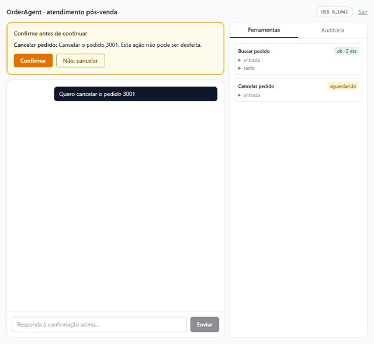

# OrderAgent

Agente de atendimento pós-venda construído sobre Claude com **tool use**. Ele consulta status de pedido, rastreio, segunda via de boleto e política de troca numa API mock de ERP. Tem limites de ação, confirmação obrigatória para efeitos colaterais, auditoria append-only e avaliação automatizada.

> O agente não deveria poder cancelar seu pedido sozinho. Aqui, ele não pode: quem decide é o servidor, não o prompt.



## Como funciona

```
UI (React) ──SSE──► API (Fastify) ── sessão: CPF + nº do pedido (RF04)
                       │
                  AgentRunner  (loop explícito, máx. 8 iterações, teto de custo)
                   │
                   ├─► Claude (tools + system prompt cacheado)
                   │      │ tool_use
                   │      ▼
                   ├─► ToolRegistry ── valida args com Zod (mesmo schema que gera a definition)
                   ├─► Authorizer ──── read → executa · effect → PAUSA e pede confirmação
                   ├─► handler ─────── filtra pelo CPF da sessão (nunca pelo que o LLM diz)
                   ├─► AuditLog ────── tudo gravado, append-only
                   │      │ tool_result
                   └──────┘ repete até: resposta final | confirmação | limite | escalada
```

### Ferramentas

| Tool | Política | O que faz |
|---|---|---|
| `buscar_pedido` | leitura | Status, itens, valor e entrega de um pedido |
| `listar_pedidos_cliente` | leitura | Pedidos do cliente autenticado |
| `rastrear_entrega` | leitura | Rastreio + flag `atrasado` calculada no servidor |
| `consultar_politica_troca` | leitura | Política da categoria + elegibilidade por dias desde a entrega |
| `gerar_segunda_via` | **efeito** | Nova via do boleto (confirmação obrigatória) |
| `abrir_chamado` | **efeito** | Chamado para a equipe humana (confirmação obrigatória) |
| `solicitar_cancelamento` | **efeito** | Cancela pedido não enviado (confirmação obrigatória) |

### Garantias que não dependem do prompt

- **Isolamento entre clientes**: os handlers usam o CPF da sessão. Pedido de outro cliente responde como "não encontrado", mesmo sob prompt injection. Ver `tests/integration/confirmation.test.ts`.
- **Confirmação**: tool de efeito pausa o turno e guarda os argumentos no servidor. Só executa o que o cliente viu e aprovou.
- **Limites**: 8 iterações por mensagem, teto de custo por conversa e escalada após 3 falhas de entendimento seguidas.
- **Auditoria**: cada mensagem, tool call (args, resultado, latência), confirmação, uso de tokens e custo. No Postgres, um trigger bloqueia UPDATE/DELETE.

## Rodando

Requisitos: Node 20+, pnpm 9. Postgres é opcional (sem `DATABASE_URL` a auditoria fica em memória).

```bash
pnpm install
cp .env.example .env   # preencha ANTHROPIC_API_KEY
```

Em três terminais:

```bash
pnpm dev:erp
```

```bash
pnpm dev:api
```

```bash
pnpm dev:web
```

Abra http://localhost:5173 e entre com os dados fictícios, por exemplo CPF `111.111.111-11` e pedido `1001`.

| Cliente | CPF | Pedidos (cenário) |
|---|---|---|
| Ana | 111.111.111-11 | 1001 atrasado · 1002 entregue, dentro do prazo de troca |
| Bruno | 222.222.222-22 | 2001 boleto vencido · 2002 cancelado |
| Carla | 333.333.333-33 | 3001 pago, sem rastreio · 3002 entregue há 82 dias |

Com Docker: `docker compose up` sobe Postgres e ERP mock.

## Testes e avaliação

```bash
pnpm test:cov
```

A suíte roda o LLM a partir de transcripts gravados, então é determinística e não tem custo. A cobertura mínima exigida é de 85%.

```bash
pnpm eval --live
```

Roda as 17 conversas de `eval/conversas.jsonl` contra o Claude de verdade (**gera custo**) e escreve `report/eval.md`. As métricas são acerto de tool, taxa de alucinação (entidades da resposta sem fonte nas tools) e escalada correta.

## Stack

TypeScript · `@anthropic-ai/sdk` (streaming, prompt caching) · Zod → JSON Schema · Fastify + SSE · PostgreSQL · React + Vite + Tailwind · Vitest.

## Status

Etapas 1 a 6 concluídas (ERP mock, tools, runner, política/auditoria, avaliação e UI); 13 arquivos de teste passando.

Avaliação ao vivo (`report/eval.md`): 16 de 17 casos aprovados, com acerto de tool de 100% e 0% de alucinação. O caso `sem-rastreio` falha no conteúdo.

## Licença

Este projeto usa **licença dupla**. O texto completo está em [LICENSE](LICENSE).

- **Uso pessoal, educacional e não comercial:** livre, nos termos da licença MIT (mantenha o aviso de copyright).
- **Uso comercial:** exige licença comercial. Isso inclui usar em produto ou serviço comercial, vender acesso ou derivados, usar em atividades com fins lucrativos e implantar em empresas.

Contato para licença comercial: ma.polli@hotmail.com
